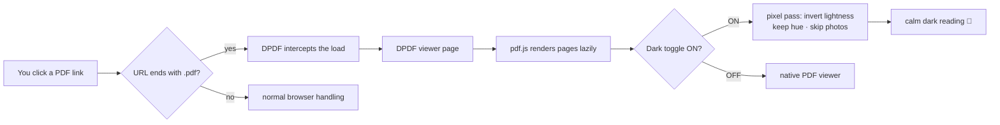
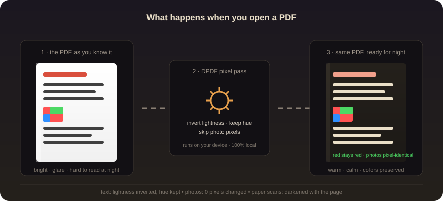

<div align="center">
  
  <p><strong>DPDF</strong> &mdash; the dark-mode PDF reader that <em>keeps every color honest</em>.<br/>
  Open any PDF on the web and it lands in a warm, calm, night-friendly viewer. Photos? Pixel-identical. Colored headings? Still red, still blue &mdash; just easy on the eyes.</p>

  
  
  
  
</div>

---

## 🎬 60-second tour

| Step | What you do | What happens |
|:---:|---|---|
| 1️⃣ | Click any PDF link (or open `something.pdf`) | The bright white page is *intercepted before it loads* and reopens inside the DPDF viewer |
| 2️⃣ | The viewer paints | Text inverts to warm cream-on-dark **while hue is preserved**, and photo regions are passed through **completely untouched** |
| 3️⃣ | Click the 🌙 DPDF toolbar icon | One switch: **Dark ON / OFF** |
| 4️⃣ | Toggle OFF | Every DPDF tab you have open instantly returns to the browser's native PDF viewer |
| 5️⃣ | Toggle ON again | Your currently-open native PDF tabs are converted back on the spot — no re-clicking links |

> 💡 The toggle **remembers itself**. Dark stays dark until *you* turn it off — even across restarts.

---

## 🚀 Install

<details open>
<summary><strong>▸ Chrome / Edge — from the folder</strong> <em>(click to collapse)</em></summary>

1. Download or clone this folder (it contains `manifest.json`).
2. Open your extensions page:
   - Chrome: `chrome://extensions`
   - Edge: `edge://extensions`
3. Flip on **Developer mode** (top-right toggle).
4. Click **Load unpacked** and select the `DPDF` folder.
5. (Recommended) Pin DPDF to the toolbar — the icon appears as a small grey PDF logo.
6. Click the DPDF icon and slide the switch to **ON**. Done. 🌙

</details>

<details>
<summary><strong>▸ Reading local PDF files (file://)</strong></summary>

For security, browsers block extensions from private files by default. To read PDFs straight from your disk:

- **Chrome**: `chrome://extensions` → DPDF → **Details** → enable **Allow access to file URLs**.
- **Edge**: `edge://extensions` → DPDF → **Details** → enable **Allow access to file URLs**.

Then open any `file:///C:/…/report.pdf` and DPDF takes it from there.

</details>

<details>
<summary><strong>▸ Verifying it works</strong></summary>

- Open a PDF you'd normally view in Chrome/Edge's white built-in viewer.
- The address bar should show the DPDF viewer page instead of the raw PDF, and the page should be warm & dark.
- Click the toolbar icon → toggle **OFF** → the tab flips back to the familiar white viewer in real time. Toggle **ON** → it darkens again.

</details>

---

## 🌙 Using it — the full procedure



**Everyday flow:**

- **Read** — scroll like a normal PDF. Pages render as they approach the screen and are released from memory when far away, so even 1000-page books stay smooth.
- **Turn dark on/off** — click the toolbar icon, move the one switch. That's the entire UI, on purpose.
- **Already have PDFs open?** Toggling ON converts every currently-open native-PDF tab immediately; toggling OFF restores them — no reload roulette.
- **Authenticated PDFs** (university portals, paywalled papers, internal servers) are fetched **with your cookies** — if you can open it in the browser, DPDF can read it.
- **Nothing is uploaded.** Rendering and the color pass run 100% in your browser.

---

## 🧠 How the color magic works

<div align="center">
  
</div>

The problem with naive "dark modes" is they average every pixel toward grey — your red heading becomes mud. DPDF's pixel pass does something smarter (the same approach used by [donepdf.com](https://donepdf.com)):

1. **Text, line-art and vector fills** — each pixel's *lightness* is inverted while its *hue and saturation are kept*. Red stays red (a touch brighter so it reads on dark), blue stays blue, only the *brightness* flips.
2. **Photos** — DPDF inspects the PDF's internal drawing operations to find exactly where raster images are placed, then checks their pixels: colorful or large ⇒ a real photo ⇒ **0 pixels are changed**. What was vivid stays vivid.
3. **Scans & paper-like regions** — bright, colorless areas (scanned documents) are darkened *with the page*, so they don't glow like a lamp.

<details>
<summary><strong>▸ The math, for the curious</strong></summary>

For each pixel with channels `r, g, b`:

```
Y      = 0.299·r + 0.587·g + 0.114·b        // luma
k      = 255 − 2·Y                          // lightness inversion
out_c  = clamp( c + k, 0, 255 )             // per channel: c = r,g,b
out_c  = bg_c + (out_c / 255) · (fg_c − bg_c)  // map white→background, black→foreground
```

- Foreground/background use a warm pair: background `rgb(42,37,34)`, foreground `rgb(234,223,200)`.
- Because the first step adds the *same* `k` to every channel, differences between channels (the hue!) survive the inversion.
- Photo detection: image rects ≥ 24×24 device pixels are sampled; a pixel counts as "paper" when `Y > 195 && chroma < 30`. If fewer than 55% of sampled pixels are paper → real photo → skipped entirely. Otherwise it's treated like paper (a scan) and darkened.

</details>

---

## ✨ Why you'll like it

- 🌙 **One-tap ritual** — a single switch, remembered across sessions.
- 🎨 **Colors that stay themselves** — the rare dark mode a designer wouldn't scream about.
- 🖱️ **Real text, really selectable** — an invisible text layer sits under your cursor, so you can select, copy and Ctrl+F like any web page.
- 📚 **Built for big documents** — lazy rendering + memory-bounded pages.
- 🔒 **Private by construction** — no accounts, no servers, no telemetry; everything is local code.
- ⚡ **Zero-click** — you never configure a site list. Every PDF, everywhere, by default.

---

## ❓ FAQ

<details>
<summary><strong>Can I select, copy and search text?</strong></summary>

Yes. Under the rendered page sits pdf.js's invisible **text layer** — real, positioned text spans that you can highlight with the mouse, copy (Ctrl+C), and search (Ctrl+F). It's the same trick Firefox's built-in PDF viewer uses, so selection behaves like an ordinary web page.

</details>

<details>
<summary><strong>Why did this one PDF stay white?</strong></summary>

It's likely not a real PDF URL — for example Google Drive preview pages or ASPX wrappers. DPDF intercepts URLs that end in `.pdf`. Download the file (right-click → Save as) and open it directly.

</details>

<details>
<summary><strong>Does it change how websites work?</strong></summary>

No. One precise rule rewrites *only* main-frame navigations to `.pdf` URLs. Everything else on the web is untouched.

</details>

<details>
<summary><strong>Where does my PDF get downloaded from?</strong></summary>

The same place it always did — the origin server, with your own cookies and auth. DPDF adds a renderer, not a proxy.

</details>

<details>
<summary><strong>Is it heavy?</strong></summary>

pdf.js is bundled locally (~2 MB, no CDN fetch). Pages render lazily and unload off-screen, capped at a sane device-pixel ratio — a large book holds only the pages you can see.

</details>

---

## 📦 What's inside

```
DPDF/
├── manifest.json          # MV3 manifest + the one DNR rewrite rule
├── background.js          # registers the redirect rule, follows the toggle
├── popup.html / popup.js  # the one-switch UI 🌙
├── viewer.html / viewer.js# pdf.js rendering + color-preserving pixel pass + selectable text layer
├── lib/                   # vendored pdf.js 4.10 (viewer, worker, fonts, cmaps)
├── icons/                 # grey PDF logo, 16→128 px
└── assets/                # this README's animated diagrams
```

## 🙏 Credits

- Built on [pdf.js](https://github.com/mozilla/pdf.js) (Apache-2.0) — the same engine Firefox uses.
- Dark-conversion approach inspired by [donepdf.com](https://donepdf.com)'s PDF Dark Mode tool and its open documentation (lightness inversion with hue preservation + photo preservation).

---

<div align="center">
  <sub>Made for people who read PDFs after sunset. 🌙 Toggle ON, and sleep your eyes deserve.</sub>
</div>
